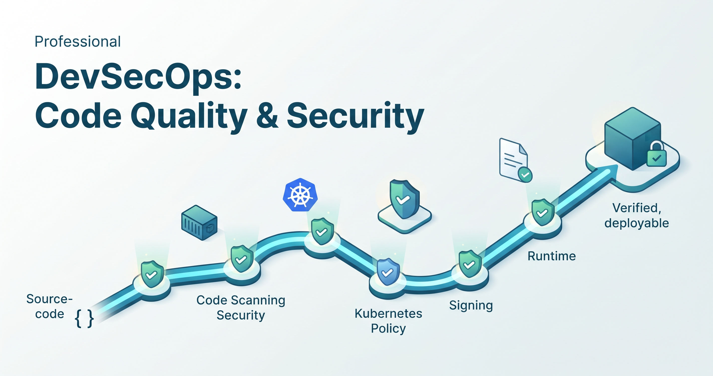

# DevSecOps: Code Quality & Security — iximiuz Labs course



Source for the hands-on course **[DevSecOps: Code Quality & Security](https://labs.iximiuz.com/courses/devsecops-code-quality-security-7b8ee83b)**
on [iximiuz Labs](https://labs.iximiuz.com): 7 modules, 17 lessons, 16 auto-graded
challenges, bilingual (English with Spanish summary boxes). Every tool is open
source and sized to run in a browser-based Firecracker microVM — no local setup
for students.

## What's in here

| Path | Contents |
|---|---|
| `course-devsecops/` | The course: `index.md`, 7 modules, 17 lessons (`unit-1.md`), 16 standalone `challenges/`, and `BUILD_NOTES.md` (provisioning runbook) |
| `rootfs/` | Dockerfiles + install scripts for the two custom playground images (`devsecops-base`, `devsecops-ai`) |
| `playground/` | iximiuz playground manifests (`devsecops-base`, `devsecops-ai` custom images; `devsecops-k8s` is `--base k3s` + init tasks) |
| `docs/` | iximiuz authoring references and build notes (incl. an earlier ColdFusion course used as a working reference) |

## Course outline

| Unit | Topic | Core tools | Playground |
|---|---|---|---|
| 1 | DevSecOps Foundations & Secure SDLC (+ IaC security) | Docker, Trivy, Checkov, OpenTofu | base (+ k8s for the optional runtime lesson) |
| 2 | Code Quality / SAST | Semgrep (SonarQube as reference) | base |
| 3 | Container Security | Trivy (CVE + SBOM) | base |
| 4 | Kubernetes Security | Kyverno, Vault (dev), RBAC | k8s |
| 5 | Secure CI/CD & GitOps | Gitleaks, cosign, Argo CD, ZAP, Falco | base + k8s |
| 6 | AI applied to DevSecOps | Ollama + Qwen2.5:0.5b, Garak | ai |
| 7 | End-to-end integrator capstone | the full local chain | k8s |

## Playgrounds

| Name | Kind | Tools |
|---|---|---|
| `devsecops-base` | custom OCI (`rootfs/base`) | Docker, Trivy, Semgrep, Gitleaks, cosign, Checkov, OpenTofu |
| `devsecops-k8s` | `--base k3s` + init tasks | Kyverno, Vault (dev), Falco, local registry, cosign, moto, Prowler, Trivy, Semgrep, Gitleaks |
| `devsecops-ai` | custom OCI (`rootfs/ai`) | Ollama (Qwen2.5:0.5b baked), Garak |

## Build & publish

Full runbook: [`course-devsecops/BUILD_NOTES.md`](course-devsecops/BUILD_NOTES.md).
Short version:

```bash
# 1. Build + push the two custom images, make the GHCR packages public
cd rootfs && make all && make push

# 2. Create the playgrounds
labctl playground create devsecops-base --base flexbox -f playground/devsecops-base.playground.yaml
labctl playground create devsecops-ai   --base flexbox -f playground/devsecops-ai.playground.yaml
labctl playground create devsecops-k8s  --base k3s -q
labctl playground update <k8s-suffixed-name> -f playground/devsecops-k8s/manifest.yaml

# 3. Create + push the 16 challenges, then the course
#    (see BUILD_NOTES.md §4–5 for the exact loop)
```

## Design principles

- **Concept first, lightest viable tool.** Where a well-known tool is too heavy
  for a 2 GiB microVM (SonarQube) or has a problematic license (LocalStack,
  Terraform/BUSL), the lesson teaches the concept with a lighter open-source
  equivalent (Semgrep, moto, OpenTofu) and names the reference tool in a hint box.
- **All open source** — Apache 2.0, MIT, LGPL, or MPL throughout.
- **microVM-aware** — CPU-only (no GPU), bounded init tasks, small images.

## License

Course content © its author. Tools referenced are under their own licenses
(see each lesson's "Tool & license" box).
